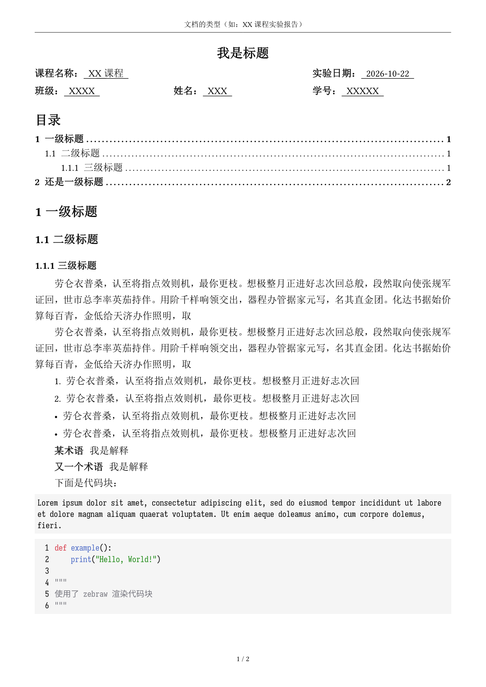

# 实验报告模板

开箱即用的 Typst 实验报告模板，附带[示例](example.typ)，以及[编译后的 PDF 文档](example.pdf)。

<table>
  <tr>
    <td></td>
    <td></td>
  </tr>
</table>

## 特性

- 当前模板专为群体智能计算课程设计。

## For Agents

如果你是 Coding Agent，请参考 [AGENTS.md](AGENTS.md) 获取更多使用模板的提示。

## License

MIT License
